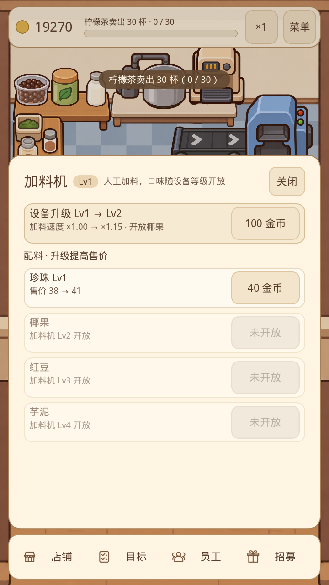
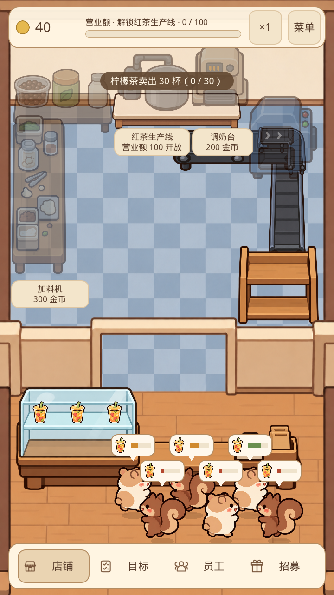

# 最新工作区游戏流程排查（2026-11-01）

测试对象：`codex/rabbit-frame-gameplay`，HEAD `aee030f2d28c74f1d62b676689fcf7d37fe82915`，包含测试开始时已有的未提交素材和配置。默认入口 `presentation/tea_playtest/tea_playtest.tscn`。引擎 Godot 4.6.3，Windows，NVIDIA RTX 3060。

结论：开局、分段开线、招募/派遣/收回、升级、物流切换、角色预览、存读档和经营任务可以完成。本轮确认 1 项售价显示缺陷、1 项排队显示缺陷，并测得明显的任务节奏问题。未修改游戏逻辑。测试使用独立 APPDATA 和专用存档，未读写玩家真实经营进度。

## 1. P2：配料升级面板的售价与实际交付收入不一致

复现步骤：

1. 解锁红茶线、调奶台和加料机。
2. 调奶台升至 Lv2，原料柜的茶叶升至 Lv2。
3. 打开加料机，查看珍珠 Lv1 升级的售价说明。
4. 升级珍珠并实际交付一杯珍珠奶茶。

实际结果：面板显示 **售价 38 → 41**；同一状态的真实售价是 **43 → 46**，升级后真实交付一杯增加 46 金币。库存审计通过。配料面板少算了茶叶和调奶台的加价，已满级配料的售价同样受影响。

原因：`presentation/tea_playtest/station_panel.gd:145`–168 使用 `base_price * bonus` 计算配料展示；`game/tea_playtest/tea_shop_sim.gd:706` 的实际售价还叠加机器、原料的加成。原料/机器面板已有实际售价预览逻辑，配料分支未统一。

建议：配料升级前后预览与实际 `_dish_price()` 共用计算，覆盖其他加价来源已升级和配料满级的状态。

证据：[截图](price-mismatch.png)、[实际交付记录](reproduce-issues.log)、[复现脚本](reproduce_issues.gd)。



## 2. P2：按引导立即开线后，上一阶段任务长期滞后

这是已测得的数值/体验问题，不是永久卡死。

复现策略：新店 50 金币，先解锁柠檬茶；收入和营业额满足条件就依次解锁红茶、调奶、加料；红茶开放后用实际收入招募并派出浣熊、狐狸；加料机可升级就升至 Lv4；不注入金币，不培养、不升级煮茶机。三位员工全部流动。

结果：

| 时刻（游戏时间） | 结果 |
| --- | --- |
| 40 秒 | 红茶线开放 |
| 185 秒 | 调奶台开放 |
| 585 秒 | 加料开放 |
| 3600 秒 | 总售出 427 杯，原味奶茶仍为 **18/20**；珍珠奶茶已售 26 杯 |
| 3600 秒 | 共生成 1036 位顾客，604 位超时离开，5 位仍在队列，流失约 58% |

同样自然收入策略，单员工 60 分钟仅售出原味 17 杯、珍珠 16 杯；三员工中两位分别坐班煮茶和加料后，60 分钟总售出 219 杯、原味 14 杯。坐班的产量下降是物流人手减少的测量结果，单独不算功能缺陷。

原因：`content/tea/art_shop_progression.tres:62` 与 `:94` 中，原味订单权重由 50% 降至 5%，但“原味卖出20杯”仍保留为任务；`game/tea_playtest/tea_shop_sim.gd:592`–600 仅在有原味订单等待且库存不足1杯时调出原味，缺少针对未完成任务的保供。加料阶段来客间隔1.5秒，顾客耐心24秒，当前生产/搬运难以匹配。

对照：开放加料后持续把煮茶机升至满级的另一条自然收入路线，**4050.1秒（67.5分钟游戏时间，4倍速约16.9分钟）**完成全部任务；逐阶段先做完20杯任务再开下一段的路线也完成。因此不应把这项描述成死锁。

建议：先确定目标通关时长，再调整原味订单/供货保底、阶段切换条件或顾客等待预算；至少避免开放新线后明显压低未完成旧任务的推进速度。

证据：[三种人员配置日志](flow-probe.log)、[自然收入脚本](flow_probe.gd)、[完整任务对照日志](flow-compare.log)、[对照脚本](flow_compare.gd)。

## 3. P2：满员排队时，前排订单气泡遮挡后排顾客

复现步骤：解锁柠檬茶，暂时收回唯一员工，等待约20秒，队列达到配置上限6人。截图将顾客移动到既定排队终点，排除进场动画的短暂重叠。

实际结果：两排顾客身体交叠，前排订单气泡盖住后排脸部；满队列时难以区分订单对应的顾客。Web实际营业画面也观察到相同的拥挤。

原因：`presentation/tea_playtest/tea_playtest.gd:269` 将两排纵坐标设为1163和1108，只有55像素间距；顾客高度110像素，加上气泡高度与偏移，相邻两排的显示区域重合。当前气泡与角色一同进行Y排序。

建议：为第二排和气泡保留足够间距，并明确订单气泡的独立显示层或错位布局。

证据：[六人队列截图](queue-six-customers.png)、[终点坐标记录](reproduce-issues.log)、[复现脚本](reproduce_issues.gd)。



## 验证覆盖与边界

- `tests/run_all.gd`：**130个用例、0失败，退出码0**。涵盖生产、自然收入任务完成、派遣/收回、配料、库存守恒和存档恢复。[日志](regression.log)
- 经营界面鼠标输入：无头及实际OpenGL渲染均0失败，包含开线、设备/配料升级、招募派遣/收回、拖拽、手动/自动/退出保存与重建场景恢复。[无头](business-gui.log)、[实际渲染](render-business.log)
- 店铺导航、菜单暂停/继续、重开确认、ESC、界面遮挡及小屏/横屏输入：0失败。[日志](shop-ui.log)
- 员工鼠标/触摸/多指/取消拖拽：实际OpenGL渲染0失败。[日志](staff-render.log)
- 兔子预览、招募、派遣、实际携货/动画和大小屏：实际OpenGL渲染0失败。[日志](rabbit-gui.log)
- 默认Vulkan Mobile渲染入口成功启动，未出现脚本或渲染错误。[日志](default-render.log)
- 当前保留的独立角色检查为 `test_rabbit_frame_atlas`、`test_rabbit_game_visuals`，均退出码0、0失败，同名日志保留于本目录。此前4项骨骼试验的脚本与历史日志均已归档到仓库外，不属于当前功能。这些检查是独立SceneTree入口，未纳入上述清理前130个用例计数。
- 本地Web Release导出成功；Chrome隔离上下文实际加载，点击柠檬茶价格牌、解锁并持续营业，金币由50上升；浏览器控制台没有error/warn。没有发布到线上，没有做Web完整任务通关或手机真机性能测试。
- Windows桌面控制遇到截屏超时及访问拒绝，不能宣称完成原生桌面人工点按；桌面交互证据来自Godot真实渲染、引擎输入事件及截图。
- 基础回归退出时仍有Canvas/ObjectDB和1个资源未释放告警；这是既有记录，本轮实际游戏渲染没有同类运行错误。刻意构造的损坏存档/写入失败警告属于测试预期。

## 复跑

PowerShell中把APPDATA指向新的独立测试目录，再运行，避免影响玩家档案：

```powershell
$env:APPDATA='D:\tmp\eatventure-repro-new\appdata'
$engine='D:\Godot_v4.6.3-stable_win64\Godot_v4.6.3-stable_win64_console.exe'
& $engine --path 'D:\Tes\eatventure' --rendering-method gl_compatibility --audio-driver Dummy --script 'D:\Tes\eatventure\docs\qa\2026-11-01-playthrough\reproduce_issues.gd'
& $engine --headless --path 'D:\Tes\eatventure' --script 'D:\Tes\eatventure\docs\qa\2026-11-01-playthrough\flow_probe.gd'
& $engine --headless --path 'D:\Tes\eatventure' --script 'D:\Tes\eatventure\docs\qa\2026-11-01-playthrough\flow_compare.gd'
```

复现脚本用于记录当前缺陷，不是修复后的回归断言。游戏时间由固定0.1秒步长推进，长时间流程通过加速模拟完成，不代表连续人工操作5小时。
