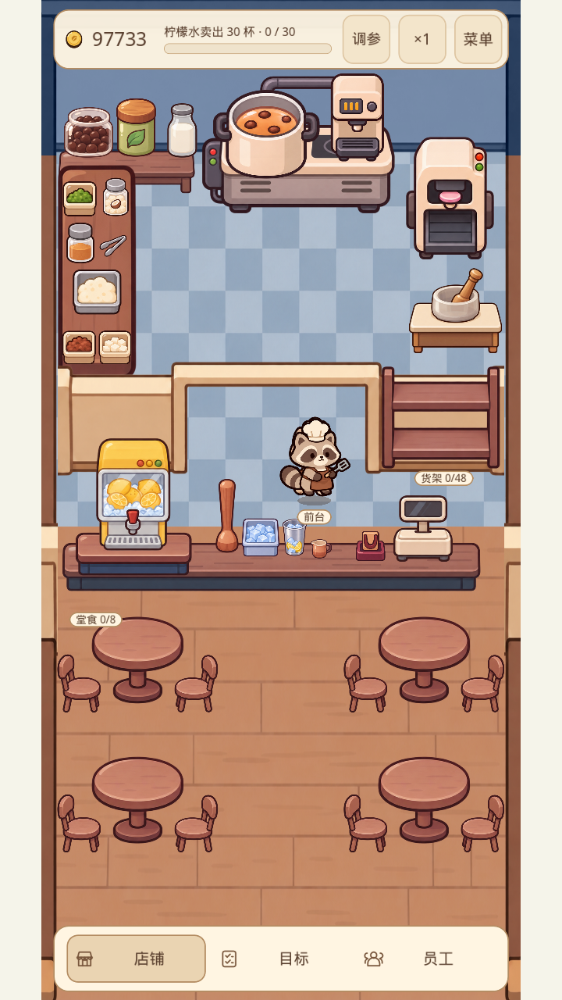
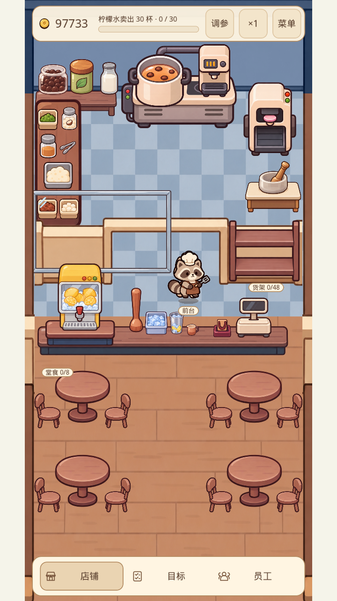

# 奶茶店独立素材与前厅布局验收

## 最终效果

`portrait.png` 为八位排队顾客和四位堂食顾客的压力画面；`small.png`、`wide.png` 分别验证小窗口和横屏布局。

## 实现范围

- 后厨机器大致保留原位置；前柜台上移 180、隔断上移 140，世界扩为 720×1500。
- 四张圆桌、八把独立椅子，显示实际堂食占用；各家具、机器和桌面工具独立。
- 新前厅柠檬手打台：柠檬水由前台员工送入新台，人工手打成柠檬茶，再交付顾客。后厨手打台图片保留，香蕉茶继续由后厨制作。
- 玻璃隔板默认隐藏，菜单可切换，视觉开关不影响经营状态。
- 按组生成素材页再拆图；16 张替换图片与 origin/main 原尺寸逐一核对一致，33 件生成成品和额外玻璃隔板均为独立透明 PNG。
- 旧存档迁移保留经营、顾客和员工；退还失效柠檬配料升级费用，恢复被新柜台阻断的待派遣/在岗员工，保留有效任务和在途库存。

## 验证

Godot 4.6.3，完整 `tests/run_all.gd`：109 用例，0 失败。

以下真实界面检查均为 0 失败：

- `tests/render_shop_ui.gd`：窗口缩放与界面边界。
- `tests/render_shop_layout.gd`：新工位点击、道具落台、玻璃切换及竖屏/小窗/宽屏。
- `tests/render_tea_business.gd`：实际营业、新旧工位鼠标与触屏点击。
- `tests/render_guide.gd`：引导和世界坐标高亮。

另经独立审查，已复现并修复旧版待派遣员工被新柜台隔断的问题；复核后待派遣/在岗员工均能恢复黑茶制作，库存审计通过。381 组非法存档字段输入均拒绝且没有运行时错误。

素材尺寸/透明通道报告见 `art_src/shop_layout_2026_11/export-verification.json`；源图、提示词与可重复拆分命令见该目录 README。

## 煮茶设备修正

根据后续确认，锅下方为带供电控制区、散热槽和厚柜体的加热工作柜，替换薄木桌。锅、调奶机及独立后连接管同页绘制后拆分；管子位于两台机器后方，随调奶机解锁显示。原有三张替换图的像素宽高不变。

后墙与木质家具仅进行参考色调校正，保留全部纹理、形状和透明通道；原图与确定性调色工具均保存在项目中。

新增原生回归核对柜体厚度、机器落台、管子两端连接、遮挡顺序及解锁显隐；测试先因缺少管子而失败，接入后通过。完整 109 用例及四项原生界面检查复跑均无失败。
