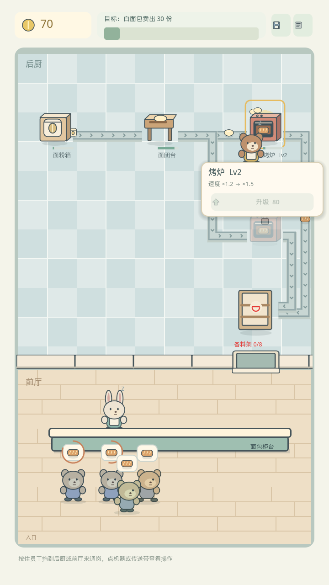
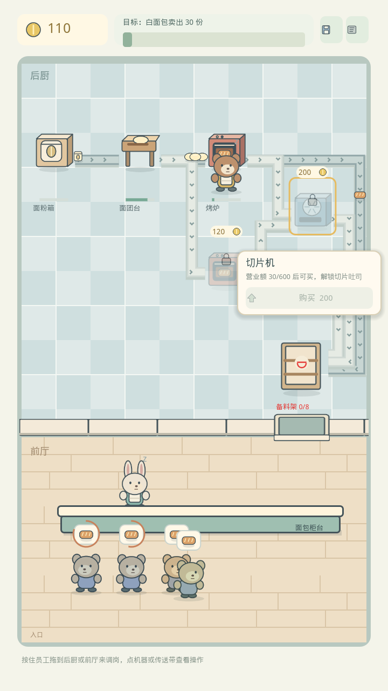
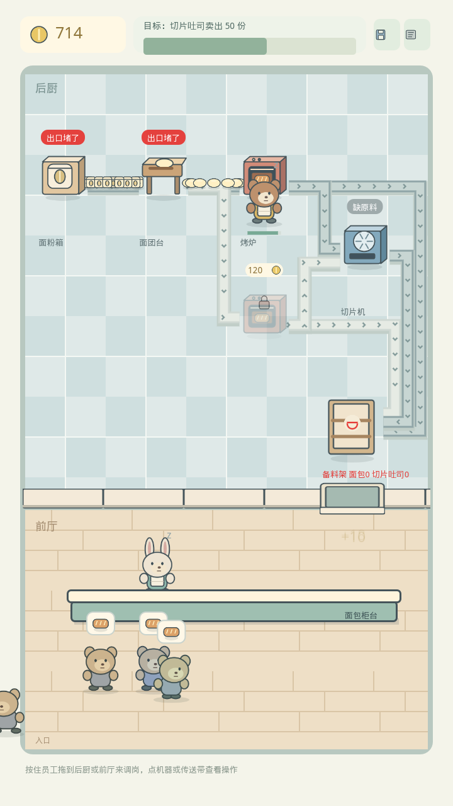
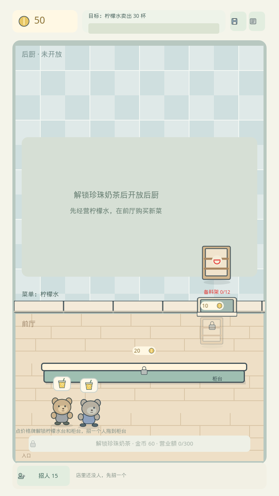
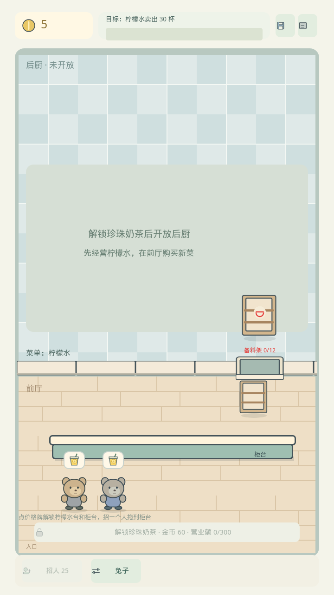
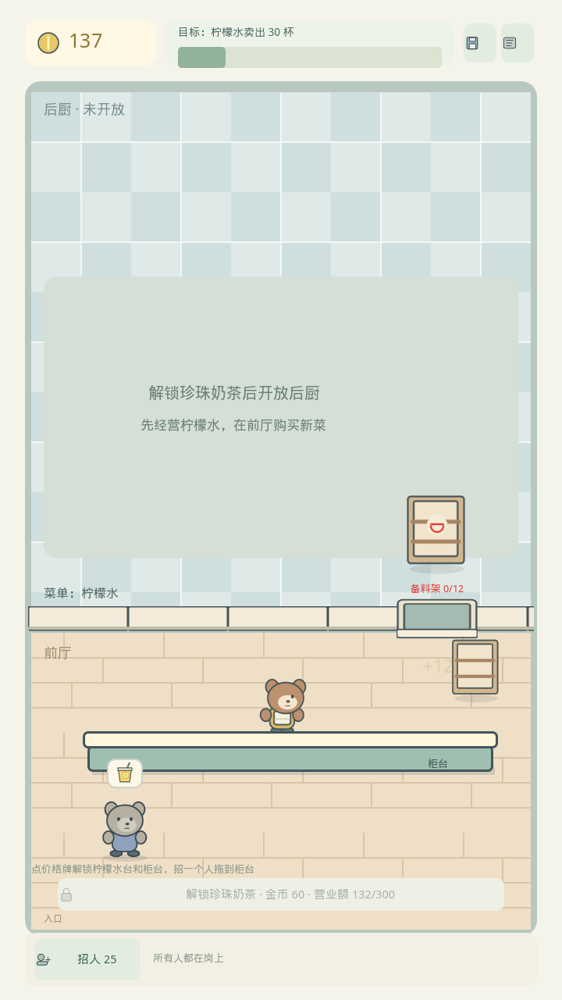

# PXJ-26 graybox verification

Godot 4.7 stable; current 2D 3/4 specification. This is a functional graybox, not an approved final art direction. The 45-degree proposal in PXJ-39 is unchanged.

## Automated checks

- `godot --headless --path . --import`
- `godot --headless --path . -s tests/run_all.gd`: **40 cases, zero failures** (32 existing + 8 presentation regressions).
- Presentation regressions cover snapshot immutability and signal rebind/detach, claimed versus unclaimed manual work, distinct input/output item identities, servers fetching from the window before serving their own customer, and idle kitchen workers staying at their last station. Both display regressions failed before correction and passed afterward.
- `git diff --check` and the project inspection script passed; Production rules and `content/` are unchanged. `App.save_now()` now returns the real write result to the UI.

## Real renderer and input

Run `godot --path . --rendering-method gl_compatibility --audio-driver Dummy -s tests/render_graybox.gd` with an X11 display. The script uses a fresh in-memory profile, pauses the simulation, advances deterministic time and submits mouse events through Godot's actual input path.

Verified: tapping a station opens its card, the card pays for an upgrade and a parallel slot, tapping the floor closes the card, dragging a worker into the kitchen submits the assignment, and reopening the world view does not change business state. All assertions passed. Rendered with Mesa llvmpipe; this proves desktop visual/input behavior, not mobile GPU performance or touch quality. Virtual-display V-Sync warning is environmental; no script errors occurred in the final render run.

Screen captures: [720×1280 shop](pxj26-whitebread.png), [station card](pxj26-card.png), [dragging a worker](pxj26-drag.png), [parallel line](pxj26-parallel.png), [540×960](pxj26-small.png), [1280×720](pxj26-landscape.png), [resource gallery](pxj26-assets.png). Landscape keeps the portrait playfield centered; it does not introduce a separate landscape layout.

## Scope

- Nineteen original transparent PNG assets and corresponding SVG source files; the largest sheet is 1280×480.
- Six workstations, staff animation sheets with idle/walk/work in three directions, one tinted customer sheet, four items and sixteen UI icons.
- Floors, divider/window, belts, item positions, stock stacking, waiting/working indicators, order bubbles, patience arcs, worker activity, income pop and selection feedback.
- Current owned roster and white-bread balance are unchanged. Slicer, cat and additional material assets are visible in the gallery, not silently enabled in the live economy.
- No free placement, hiring, restart, rotation or hint action is invented; the supplied future-action icons have no misleading live buttons. Current fixed-slot gameplay uses the existing command API.
- Broader symptom usability testing remains PXJ-24. New content remains PXJ-35/37. PXJ-26 stays In Progress until the PR is merged and its P0 review is accepted.

## Follow-up: scale, staffing and interaction pass

- Machines are drawn at the character scale (0.6 of the 128×160 source); slots are spaced so belts run between machines instead of behind them.
- Kitchen workers wait beside the last station they served. Front workers fetch from the pass-through window, then hand the dish over at that customer's place along one long service counter; idle front workers take separate spots.
- Tapping a station or belt opens a card beside it (upgrade / enable, or disconnect / clear belt). Workers are reassigned by dragging them onto the kitchen or front hall; the target zone highlights while dragging.
- Stuck belts turn red after one second of a blocked head item; "blocked" uses the warning red reserved by the art list.
- `docs/` carries a `.gdignore`, so QA images are no longer imported as game resources.

## PR #5 review corrections

- Saving reports success only after the actual write and rename succeed; failures show the write error. Regression coverage uses a real invalid destination and a real successful save file.
- Server travel speeds fit the service duration including staff efficiency and the progress already elapsed when a snapshot arrives. Pickup and completion snapshots reconcile skipped render frames; dragging cancels the local motion before the next snapshot resumes it. Economy and service timing are unchanged.
- The motion regression advances actual actor positions at the simulation cadence and covers all three counter levels. It checks arrival at the window before carrying and arrival at the customer before the completion snapshot, so snapping at a phase boundary cannot conceal a too-slow walk.
- The bundled font subset was regenerated from the licensed source, including the new drag hint and parallel-card glyphs. Font coverage has a runtime regression.
- These three regression cases failed against the reviewed head before correction and passed afterward. Expected warnings from deliberate save-failure and corrupt-save fixtures are not application errors.

The corrected head also passed Godot 4.7 import and the real X11 renderer/input script (card upgrade, parallel activation, floor dismissal, drag assignment, release over GUI, cancellation, rebind, 720×1280 / 540×960 / 1280×720). Screenshots were inspected; Mesa llvmpipe was used, so this is not a mobile performance or Web gameplay result.

## PXJ-40 second dish: sliced toast

Run `xvfb-run -a godot --path . --rendering-method gl_compatibility --audio-driver Dummy -s tests/render_toast.gd`. Fresh profile, paused simulation, synthetic input.

Verified: the slicer ghost card names the revenue goal and cannot be bought before 600; after 600 the card button buys it and the shop enters stage 2; the ovens split bread between the rack and the slicer and toast sells in the live scene. The original `tests/render_graybox.gd` still passes with the new layout (its PXJ-26 screenshots are left as they were).

Display changes: kitchen columns are 80 px apart so the slicer fits right of the ovens; rack feeders get one lane each down the right wall (higher machine, outer lane); belts to a locked or empty slot are drawn pale and still; the rack shows each menu item's count; the goal bar counts tasks of dishes not yet unlocked.

Font: the UI font is a glyph subset built from the repo's text. "切片吐司" added 吐 and 司, which the old subset lacked (the first PXJ-40 screenshots showed boxes). Regenerated with `python3 art_src/graybox/subset_font.py /usr/share/fonts/truetype/wqy/wqy-microhei.ttc` (598 → 601 glyphs, none lost). `tests/test_font.gd` now fails when a content name, task name or a string literal in `presentation/` or `game/` uses a character the font lacks; it failed on the old font and passes on the new one.

## PXJ-46 布局阶段 1：空店开局、前厅点解锁、员工栏

跑法同上，脚本换成 `tests/render_tea.gd`。新档开局、模拟暂停、合成输入。

验收过的一条路：开局空店只有环境和两个价格牌（金币 50）→ 点柠檬水台（10）、点柜台（20）→ 点「招人」（15）→ 把员工栏里的卡片拖到柜台 → 柜台服务员开始卖柠檬水 → 营业额到 300 后前厅按钮买下煮珍珠锅，后厨出现 → 再招一人调去后厨，奶茶卖出。全部断言通过（`TEA INPUT QA failures=0`）。

柠檬水台是饮水机式出品台：不配员工、不囤杯、不限量，服务员接单后过去现打，打一杯的时间加在柜台服务时间上，升级柠檬水台能提高前厅产能。这一条有无头回归覆盖。

后厨这一段仍是 v1.1 的固定机位和工作区派工，布局模式见 PXJ-47。PXJ-42 时期的 pxj42-*.png 是旧前厅（柠檬原液箱 + 封口台）的记录，流程已被本阶段取代。

## PXJ-47 布局阶段 2

- `godot --headless --path . -s tests/run_all.gd`: **62 cases, zero failures** (new `test_layout`; bakery, white-bread and toast tests removed with the bakery).
- `xvfb-run -a godot --path . --rendering-method gl_compatibility --audio-driver Dummy -s tests/render_tea.gd`: zero failures. The script drives empty shop → front unlock → hire and drag to the counter → lemonade → milk tea opens by revenue → layout button → drag the cabinet from the device bar onto its recommended spot → one-click deploy → confirm → drag a cook onto the milk station work cell → milk tea sells → device card → save round trip → 540×960.
- Kitchen is a 6×5 grid of square cells; the dashed ghosts are the recommended spots, beige cells are walls that take the 原料柜, belts route automatically.

Screen captures: [empty shop](pxj47-empty-shop.png), [kitchen opens](pxj47-kitchen-open.png), [layout ghosts](pxj47-layout-ghosts.png), [draft after deploy](pxj47-layout-draft.png), [milk tea line](pxj47-milk-tea.png), [device card](pxj47-device-card.png), [540×960](pxj47-small.png).

Known graybox limits: the floor texture's tiles do not line up with the 106 px grid; the 货架口 label sits under the shelf art.
