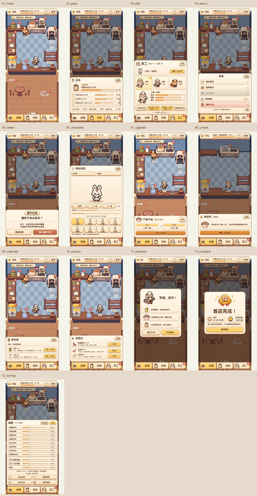

# 原生 UI 还原与视觉复核

分支：`codex/native-ui-reference-20261106`，基于 `codex/pancake-scene-v04` 的 `a066a08`。工作目录为 `D:/Tes/eatventure`，没有创建额外 worktree。推送 PR 前已同步 `main`（`c3c8265`）。保留最新主线的默认煎饼摊入口 `presentation/pancake/pancake_play.tscn`；本次皮肤接入的是奶茶店场景 `presentation/tea_playtest/tea_playtest.tscn`。

## 实现边界

原始 13 张效果图是视觉基准，不以此前的 Figcraft 近似稿替代。纸面、木色底托、按钮、卡片、进度条、滑条、开关均由 Godot 原生几何、StyleBox 和程序渐变绘制。简单图标用代码定义的 SVG 几何构造并缓存。运行时不加载完整效果图或 Figcraft 截图作为底板。

金币、角色、设备、饮品、原料、椅子和货架复用现有资源。独立位图仅新增奖章和喇叭；原始图、裁剪坐标、哈希与处理方式见 `art/ui/reference/provenance.json`。角色造型与姿势按已批准方案保留现有资产。

经营数值、购买校验、员工部署和存档仍取自主线模拟器。升级对比沿用主线的小数售价格式，不截断到整数；新增相应渲染断言。字体重新从完整授权字库生成，覆盖主线和 UI 新增文字。价格与升级效果直接显示在触屏可读的位置，不为了复刻截图文字而伪造经营数据。

## 可复核产物




- `output/native-ui/comparison.html`：13 屏原图/实机并排，点击查看原始分辨率。
- `output/native-ui/comparison_overview.jpg`：全屏对照总览。
- `output/native-ui/overview.jpg`：最新 Godot 13 屏总览。
- `output/native-ui/01_home.png` 至 `13_tuning.png`：720×1280 实际 OpenGL 渲染。
- `output/native-ui-reference/style-smoke.png`：原生几何、渐变、圆角、按钮各状态、进度/滑条的像素检查图。

这些本地 QA 产物按项目原有规则不进入 Git。可重建：先运行 `tests/render_native_ui.gd`，再用带 Pillow 的 Python 执行 `tools/build_native_ui_review.py`。原始 PNG 需位于分析时的 references 目录，或通过脚本 `--references` 参数指定。

## 原生组件与接入

| 内容 | 实现 |
| --- | --- |
| 共享纸面、木色、按钮、金色选中态 | `presentation/ui/reference_style.gd`、`reference_theme.gd` |
| 图标与原有素材映射 | `presentation/ui/reference_icons.gd` |
| 玻璃开关装饰 | `presentation/ui/reference_toggle.gd`，真实 Button 负责状态和输入 |
| 店铺、目标、员工、菜单、重开 | `presentation/tea_playtest/shop_hud.gd` / `.tscn` |
| 升级、解锁、原料柜、收银台 | `presentation/tea_playtest/station_panel.gd` |
| 欢迎、首店完成 | `presentation/tea_playtest/guide_overlay.gd` |
| 角色实际动画和方向 | `presentation/characters/character_preview.gd` |
| 调参、录制操作 | `presentation/tea_playtest/tuning_panel.gd` |

关键修正包括：三列员工卡、金色勾选标记、店铺页签在次级页保持选中、非员工底板停在导航上方、顶部主目标与瓶颈提示分开显示。已解锁设备页保持背景明亮，通过透明 Shade 保留点击空白关闭的触控行为。菜单底部进入调参，避免挤占顶部经营目标。

## 验证环境与命令

本机实测为 Godot **4.6.1 stable**、Windows、OpenGL 3.3 Compatibility、RTX 3060。测试注入模拟器；`APPDATA` 指向 `output/native-ui-test-user`，不读取或覆盖日常经营存档。

```powershell
$env:APPDATA='D:/Tes/eatventure/output/native-ui-test-user'
$engine='D:/Tes/Godot_v4.6.1-stable_win64.exe/Godot_v4.6.1-stable_win64_console.exe'
& $engine --headless --path . -s tests/run_all.gd
& $engine --headless --path . -s tests/render_shop_ui.gd
& $engine --headless --path . -s tests/render_tea_business.gd
& $engine --headless --path . -s tests/render_tuning.gd
& $engine --headless --path . -s tests/render_guide.gd
& $engine --path . --rendering-method gl_compatibility --audio-driver Dummy -s tests/test_reference_style.gd
& $engine --path . --rendering-method gl_compatibility --audio-driver Dummy -s tests/render_native_ui.gd
& $engine --path . --rendering-method gl_compatibility --audio-driver Dummy -s tests/render_rabbit_game_integration.gd
```

`render_rabbit_game_integration.gd` 等待真实绘制信号，必须使用实际渲染器。不要以 headless 运行该脚本。

复核发现并修正了：金币图标压住价格、员工升级费用/效果只在 tooltip 显示、选中徽章按纹理原始尺寸放大，以及设备页移除 Shade 后空白处不能关闭的回归。使用真实点击、触屏、拖拽和像素采样复验，不只检查脚本能否解析。

## 本轮验证结果

| 检查 | 结果 |
| --- | --- |
| `run_all.gd` 经营、存档、资源、字体 | 122 个用例，0 失败 |
| `render_shop_ui.gd` 真实点击、滚动裁剪、拖拽 | 0 失败 |
| `render_tea_business.gd` 设备购买、触屏关闭、经营入口 | 0 失败 |
| `render_tuning.gd` 调参、恢复、录制 | 0 失败 |
| `render_guide.gd` 引导流程 | 0 失败 |
| `test_reference_style.gd` 实际 OpenGL 像素与样式状态 | 0 失败 |
| `render_native_ui.gd` 13 屏、选中徽章尺寸、可见价格、横竖屏边界 | 0 失败 |
| `render_rabbit_game_integration.gd` 真实渲染下预览、招聘、部署、存档 | 0 失败 |
| `run_pancake_scene.gd` 主线煎饼摊场景 | 9 个用例，0 失败 |
| `render_pancake_guide.gd` 主线煎饼摊引导点击 | 0 失败 |
| `git diff --check` | 通过 |

截图捕获等待布局稳定，并让短暂收入飘字消退、隐藏过渡 toast；不改动经营数值。独立代码复核已确认价格排版、触屏购买信息、员工选中标记和透明 Shade 的输入行为。

## 视觉验收的实际限制

这版已完成原生接入与逐屏复核，但**不声称已达到与原图逐像素一致**。仍可见的差别包括：

- 使用现有授权的文泉驿字体加粗，字形与原稿不完全相同。
- 原生圆角、渐变、边线为规则几何；原稿中的局部柔和晕染、手绘边缘与细微纹理尚非完全相同。
- 已批准复用的角色造型、现有动画方向和设备本体继续使用原始游戏资源。
- 截图中的顾客数量、机器解锁阶段、售价、容量与升级效果反映真实模拟器状态，因此不与静态效果图中的示例数据逐项相同。
- 为让触屏购买前能看到信息，员工升级按钮增加了真实费用和效果；角色预览保留实际帧数、速度和可用动作提示。

视觉对照用于评估这些差异。功能测试通过不能替代原图还原验收。
