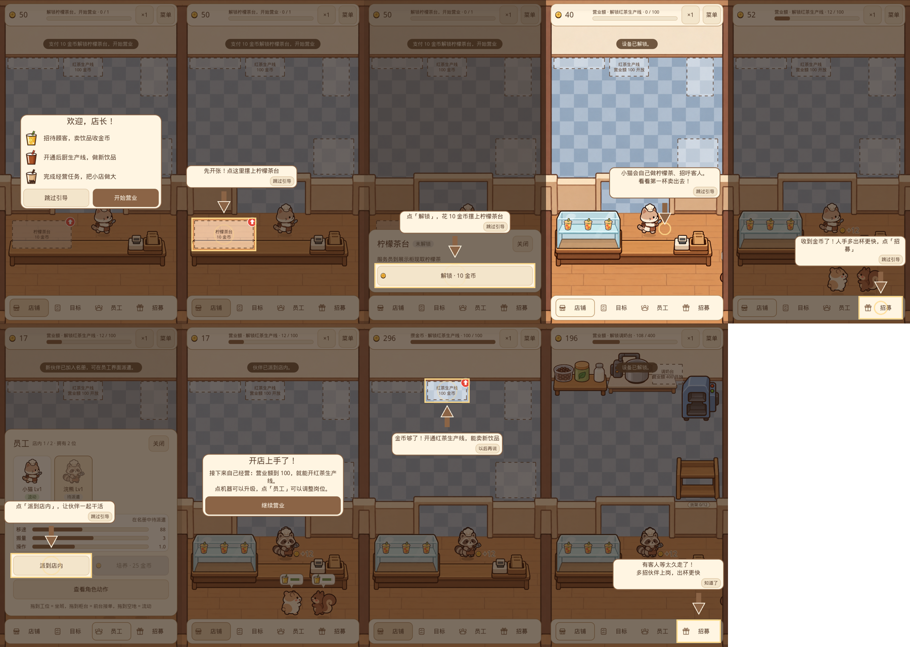

# 首店新手引导（PXJ-36）

按 2026-10-26 定下的引导设计做进当前奶茶店（固定产线、员工走动、无传送带）。引导状态每帧从经营模拟和界面现读，关掉面板、退出重进都会接着当前该做的一步。

## 流程

| 步骤 | 画面 | 压暗并暂停 |
| --- | --- | --- |
| 欢迎卡 | 「欢迎，店长！」三条目标：卖饮品收金币 / 开通后厨生产线 / 完成经营任务；「开始营业」或「跳过引导」 | 是 |
| 摆上柠檬茶台 | 手指点「柠檬茶台 10 金币」地面虚线框 → 面板里点「解锁」 | 是 |
| 第一杯卖出 | 气泡指着收银台，小猫自己做、自己卖 | 否（店照常营业） |
| 招第二位伙伴 | 手指点底栏「招募」→「邀请伙伴」；金币不够时提示攒到多少 | 是 |
| 派到店内 | 手指点「员工」→ 自动选中待派遣的伙伴 →「派到店内」 | 是 |
| 完成卡 | 「开店上手了！」说明营业额到 100 开红茶生产线 | 是 |

之后各只出现一次：

- **能开下一条线时**（营业额够、金币够、当前在店铺页）：手指点那条线的虚线框 →「解锁」；可点「以后再说」。红茶线、调奶台、加料机各一次。
- **第一次有客人等太久走掉**：店内名额没满就指「招募」，满了就指柠檬茶台去升级；「知道了」关闭。

看过哪些引导存在 `tea_shop.json` 外层的 `guides` 字段，不进经营状态本身（经营存档仍是 v3，旧存档照常读取）。旧存档已经开张且店里有 2 人的，开场引导自动跳过。重开店铺不会重放引导。测试里直接注入模拟的场景不开引导，只有游戏真正读档启动时才开。

## 和 10-26 设计稿的差别

- **删掉**：第一次布局模式教学（拖第一台设备、一键部署、确认铺带）——自由布局已在 10-27 取消，现在是固定产线。
- **删掉**：「货架空」「全满停线」瓶颈引导——传送带已取消，现在没有会停线的状态；只保留「客人走掉」这一种。
- **改**：开场「招人上岗」——现在开局已有一只小猫在店里，所以改成「卖出第一杯 → 招第二位伙伴 → 派到店内」，正好用满柠檬茶阶段的 2 个名额。
- **改**：欢迎卡第三条「做完任务开下一家店」→「完成经营任务，把小店做大」，因为下一家店还没做。
- **新增**：每条新生产线能买时的一次性引导（设计稿写的「以后遇到新东西再插入短时间引导」）。
- 字体是子集，「老、赚、钱、教、学」等字不在里面，所以用「店长」「收金币」「跳过引导」等措辞。
- 手指目前是代码画的箭头加光圈，等正式美术。

## 验证

- `godot --headless --path . -s tests/run_all.gd`：137 个用例 0 失败（含字体缺字检查）。
- `tests/render_guide.gd`（已加进 CI）：真实点击走完整个开场；高亮外的点击被吞掉；压暗时经营时间不走；完成后写入存档；红茶线引导、客人走掉引导各只出一次；重开游戏记得看过的引导；旧存档跳过开场。
- `xvfb-run godot --path . --rendering-method gl_compatibility -s tests/render_guide.gd` 出截图，拼成下图：

